<div style="display: flex; justify-content: space-between; align-items: center;"></div>

<br>
<br>
<br>
<br>

# <center>**TECNOLÓGICO NACIONAL DE MÉXICO**
## <center>**INSTITUTO TECNOLÓGICO DE MILPA ALTA II**

<br>

### <center>INGENIERIA EN SISTEMAS  COMPUTACIONALES
### <center>SEMESTRE: 5

<br>

### <center>ADMINISTRACIÓN DE BASES DE DATOS
### <center>BOLLAS PAREDES DIEGO ALBERTO

<br>

#### <center><u>**MIGRACIÓN DE UNA BASE DE DATOS EN MARIADB**</u>

<br>

#### <center> MARTINEZ VELASCO LIZETH
#### <center>NO.C. 241190035

<br>
<br>
<br>
<br>
<br>
<br>
<br>
<br>

<p style="text-align: right;">26/noviembre/2026</p>

<br>
<br>
<br>

---

<br>

### **INTRODUCCIÓN**

<br>
<br>

La migración de bases de datos es un proceso que consiste en trasladar la información de una base de datos de un origen hacia un destino, conservando su estructura, registros y relaciones.

Este procedimiento es importante cuando se necesita cambiar de servidor, actualizar un sistema, realizar copias de seguridad o trasladar información a una nueva base de datos.

MariaDB cuenta con diferentes herramientas que permiten realizar este proceso desde la terminal, como **mariadb**, que permite administrar las bases de datos, y **mariadb-dump**, que permite exportar su estructura y contenido.

En esta práctica se realizó una migración de una base de datos llamada **biblioteca** hacia una nueva base llamada **biblioteca_nueva**.

Durante el procedimiento se crearon tablas, se insertaron registros, se generó una vista, se realizó un respaldo de seguridad y posteriormente se exportó e importó la información. Finalmente, se realizaron diferentes pruebas para comprobar que la migración conservara correctamente los datos y las relaciones entre las tablas.

<br>
<br>
<br>
<br>
<br>
<br>
<br>
<br>
<br>
<br>

---

<br>

### **DESARROLLO**

<br>
<br>

#### Paso 1. Preparación del entorno de trabajo

Primero se abrió la terminal de Ubuntu para trabajar con MariaDB y se creó una carpeta para organizar los archivos de la práctica.

<br>

<center>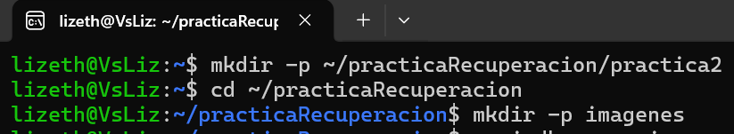</center>

<br>

Con esto se preparó el espacio de trabajo donde se organizaron los documentos y las evidencias del procedimiento.

<br>

#### Paso 2. Creación de la base de datos de origen

Se ingresó al administrador de MariaDB y una vez dentro del sistema, se creó la base de datos llamada **biblioteca**.

<br>

<center>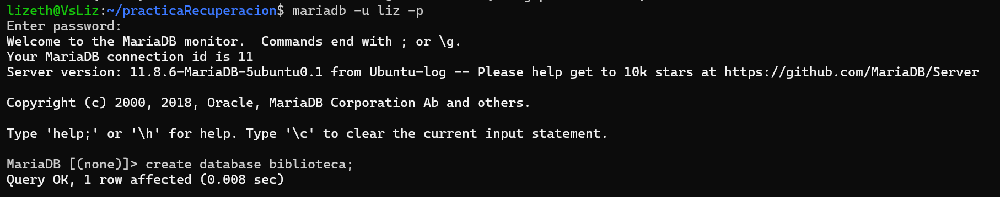</center>

<br>

Posteriormente se crearon las tablas necesarias para almacenar la información.

- Primero se creó la tabla **autores**:

<br>

<center>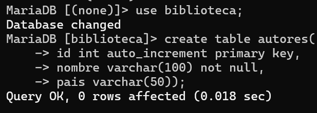</center>

<br>

- Después se creó la tabla libros:

<br>

<center>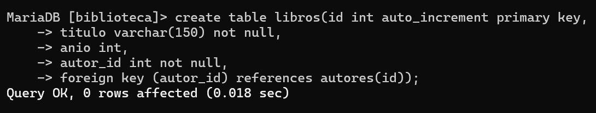</center>

<br>

La tabla libros contiene una clave foránea llamada **`autor_id`**, que permite relacionar cada libro con su respectivo autor.

<br>

#### Paso 3. Inserción de registros

- Se agregaron tres autores a la tabla correspondiente.

<br>

<center>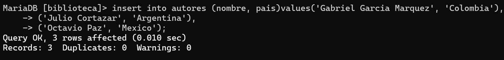</center>

<br>

- Después se insertaron cuatro libros:

<br>

<center>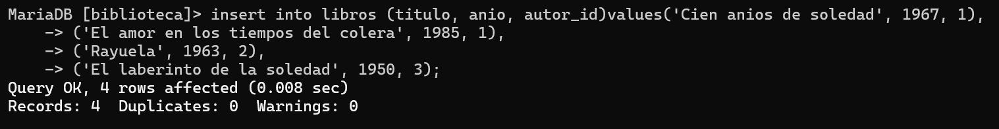</center>

<br>

Con estas instrucciones se registraron los datos que posteriormente serían migrados.

<br>

#### Paso 4. Creación de la vista

Se creó una vista llamada **`v_libros_autor`**, cuya función es mostrar los títulos de los libros junto con el año de publicación y el nombre de sus autores.

<br>

<center>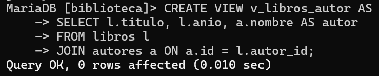</center>

<br>

Para comprobar su funcionamiento se ejecutó:

<br>

<center>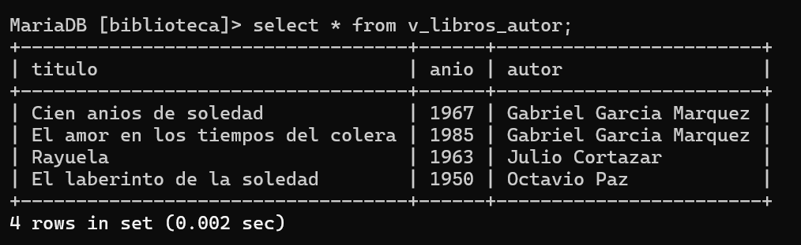</center>

<br>


Se visualizaron correctamente los cuatro libros con sus respectivos autores.

La vista permitió comprobar que la relación entre ambas tablas funcionaba correctamente.

<br>

#### Paso 5. Registro de los datos originales

Antes de realizar la migración se consultó la cantidad de registros de cada tabla y se obtuvieron sus valores de checksum.

Se utilizó el siguiente comando:

<br>

<center>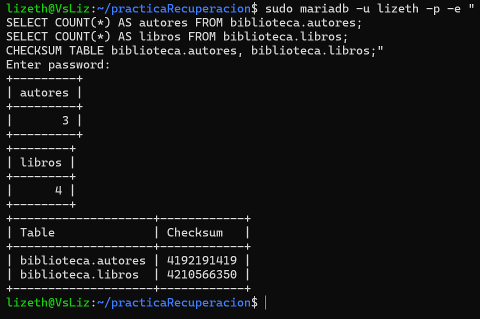</center>

<br>

Estos valores se guardaron para compararlos posteriormente con los de la base de datos de destino.

<br>

#### Paso 6. Creación del respaldo de seguridad

Antes de realizar la migración se generó un respaldo de la base de datos original.

Se utilizó la herramienta **`mariadb-dump`** mediante el siguiente comando:

<br>

<center>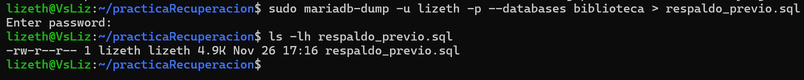</center>

<br>

Este comando permitió generar un archivo llamado **`respaldo_previo.sql`**, que contiene una copia de seguridad de la base de datos.

Para comprobar que el archivo se había creado correctamente se ejecutó:

<br>

```bash
ls -lh respaldo_previo.sql
```

<br>

El archivo **`respaldo_previo.sql`** apareció correctamente en la carpeta de trabajo.

Este respaldo es importante porque permite recuperar la información original en caso de que ocurra algún problema durante la migración.

<br>

#### Paso 7. Exportación de la base de datos

Después de generar el respaldo se realizó la exportación de la base de datos **`biblioteca`**.

Se utilizó el siguiente comando:

<br>

<center>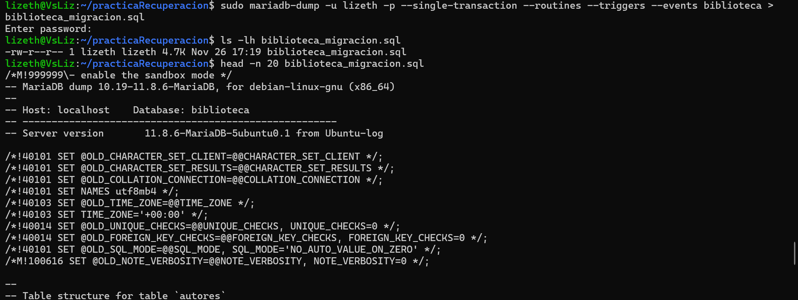</center>

<br>

El comando generó el archivo **`biblioteca_migracion.sql`**, que contiene la estructura y los datos de la base de datos.

Las opciones utilizadas fueron:

- **`--single-transaction`**: permite generar una copia consistente de las tablas transaccionales.
- **`--routines`**: incluye procedimientos y funciones almacenados.
- **`--triggers`**: incluye los triggers.
- **`--events`**: incluye los eventos.

Para comprobar que el archivo se había generado se ejecutó:

<br>

```bash
ls -lh biblioteca_migracion.sql
```

<br>

El archivo apareció con un tamaño aproximado de 4.7 KB.

También se revisó su contenido mediante:

<br>


```bash
head -n 20 biblioteca_migracion.sql
```

<br>

#### Paso 8. Creación de la base de datos de destino

Una vez generado el archivo de exportación, se creó una nueva base de datos llamada **`biblioteca_nueva`**.

Se utilizó el siguiente comando:

<br>

<center>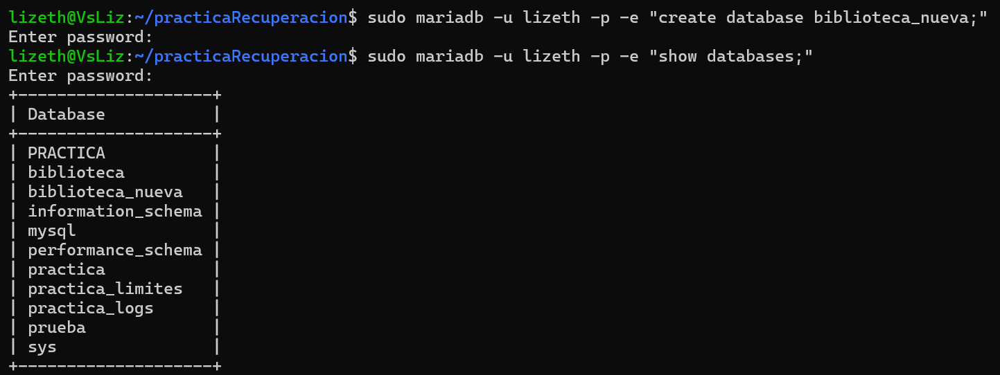</center>

<br>

Después se comprobó que ambas bases existieran con:

<br>

```bash
sudo mariadb -u lizeth -p -e "show databases;"
```

<br>

Se visualizaron correctamente las dos bases de datos:

- **`biblioteca`**: base de datos original.
- **`biblioteca_nueva`**: base de datos de destino.

<br>

#### Paso 9. Importación de la información

En este paso se realizó la importación del archivo SQL hacia la nueva base de datos.

Se utilizó el siguiente comando:

<br>

<center>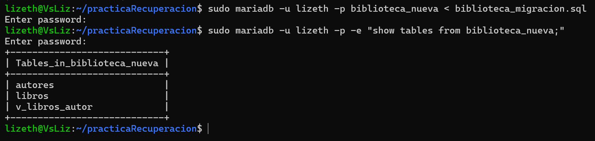</center>

<br>

Este comando permitió cargar la estructura y los datos exportados anteriormente en la base de destino.

Posteriormente se comprobó que las tablas y la vista estuvieran presentes:

<br>

```bash
sudo mariadb -u lizeth -p -e "show tables from biblioteca_nueva;"
```

<br>

Se visualizaron correctamente los siguientes objetos:

- autores
- libros
- v_libros_autor

Esto permitió comprobar que la importación se había realizado correctamente.

<br>

#### Paso 10. Validación de la cantidad de registros y checksum

Después de importar la información se realizaron nuevamente las consultas de conteo y checksum, pero ahora sobre la base de datos de destino.

Se ejecutó:

<br>

<center>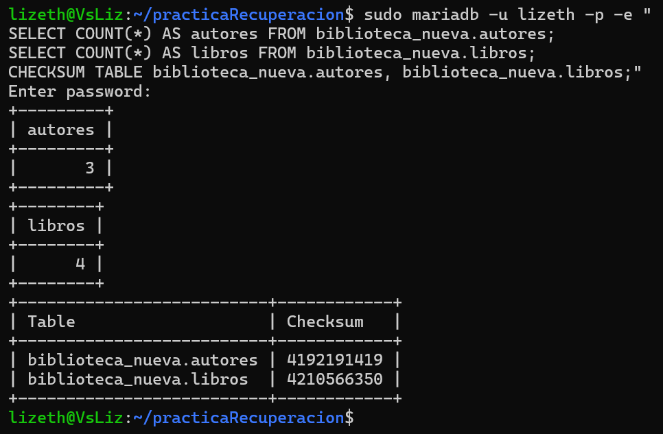</center>

<br>

Los valores de checksum coincidieron en ambas bases de datos, al igual que la cantidad de registros.

Esto permitió comprobar que la información se había transferido correctamente.

<br>

#### Paso 11. Verificación de la vista

Para comprobar que la vista también se había migrado correctamente, se ejecutó:

<br>

<center>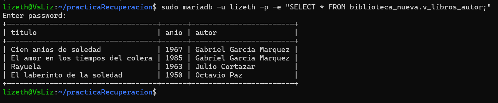</center>

<br>

Se visualizaron nuevamente los cuatro libros con sus respectivos autores.

Esto confirmó que la vista funcionaba correctamente en la nueva base de datos.

<br>

#### Paso 12. Verificación de la integridad referencial

Para comprobar que la clave foránea continuara funcionando después de la migración, se intentó insertar un libro relacionado con un autor inexistente.

Se ejecutó:

<br>

<center>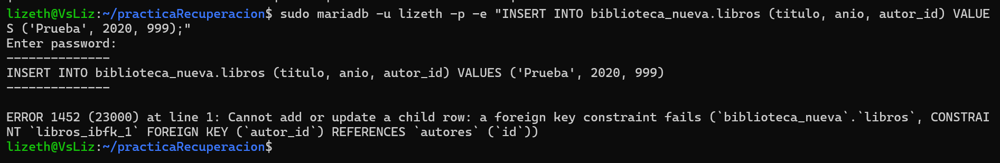</center>

<br>

MariaDB mostró el error 1452, indicando que no era posible agregar o actualizar el registro debido a una restricción de clave foránea.

Este resultado fue el esperado, ya que el autor con identificador 999 no existe en la tabla autores.

Por lo tanto, se comprobó que la restricción de integridad referencial continuaba funcionando después de la migración.

<br>

#### Paso 13. Verificación de la estructura de la tabla

Finalmente se consultó la estructura de la tabla **`libros`** en la base de destino.

Se utilizó el siguiente comando:

<br>

<center>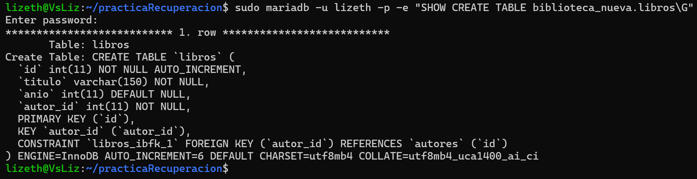</center>

<br>

Esta instrucción permite visualizar la definición de la tabla, sus columnas, la clave primaria y la clave foránea.

Se realizó la consulta de la estructura de la tabla para comprobar que se conservaran sus elementos y la relación entre libros y autores.

<br>

#### 14. Tabla general de resultados

Después de realizar las pruebas de validación se obtuvo la siguiente comparación:

| **Comprobación** | **Origen** | **Destino** | **¿Coincide?** |
|--------------|--------|---------|------------|
|**Filas en autores**| 3| 3| Sí|
|**Filas en libros**| 4| 4| Sí
|**Checksum autores**| 4192191419| 4192191419| Sí
|**Checksum libros**| 4210566350| 4210566350| Sí
|**Vista v_libros_autor**| Funciona| Funciona| Sí
|**Clave foránea**| Activa| Activa| Sí

<br>
<br>
<br>
<br>
<br>
<br>
<br>

---

<br>

### CONCLUSIÓN

<br>
<br>

Durante esta práctica se realizó exitosamente la migración de una base de datos utilizando MariaDB desde la terminal de Ubuntu.

Primero se creó la base de datos biblioteca, en la cual se agregaron las tablas autores y libros, así como una vista para relacionar los libros con sus respectivos autores.

Posteriormente, se generó un respaldo de seguridad y se exportó la información mediante la herramienta mariadb-dump. Después se creó una nueva base de datos llamada biblioteca_nueva, donde se importó el archivo SQL generado.

Para comprobar que la migración fuera correcta, se compararon los registros y los valores de checksum de ambas bases de datos. Se obtuvieron los mismos resultados: tres autores y cuatro libros.

También se comprobó que la vista funcionara correctamente y que la restricción de clave foránea continuara activa, mediante una inserción de prueba que fue rechazada por MariaDB.

---