<div style="display: flex; justify-content: space-between; align-items: center;"></div>

<br>
<br>
<br>
<br>

# <center>**TECNOLÓGICO NACIONAL DE MÉXICO**
## <center>**INSTITUTO TECNOLÓGICO DE MILPA ALTA II**

<br>

### <center>INGENIERIA EN SISTEMAS  COMPUTACIONALES
### <center>SEMESTRE: 5

<br>

### <center>ADMINISTRACIÓN DE BASES DE DATOS
### <center>BOLLAS PAREDES DIEGO ALBERTO

<br>

#### <center><u>**RECUPERACIÓN DE UN SGBD**</u>

<br>

#### <center> MARTINEZ VELASCO LIZETH
#### <center>NO.C. 241190035

<br>
<br>
<br>
<br>
<br>
<br>
<br>
<br>

<p style="text-align: right;">26/noviembre/2026</p>

<br>
<br>
<br>

---

<br>

### **INTRODUCCIÓN**

<br>
<br>

La recuperación de bases de datos es un procedimiento importante para garantizar la seguridad y disponibilidad de la información almacenada en un sistema gestor de bases de datos.

En esta práctica se trabajó con MariaDB para aprender a realizar respaldos y restauraciones de una base de datos, así como recuperar información mediante el uso del registro binario (binlog).

Se creó una base de datos llamada "tienda", en la cual se almacenaron registros de clientes. Posteriormente, se realizó un respaldo, se simuló la pérdida de información mediante la eliminación de registros y se recuperaron los datos utilizando las herramientas proporcionadas por MariaDB.

<br>
<br>
<br>
<br>
<br>
<br>
<br>
<br>
<br>
<br>

---

<br>

### **DESARROLLO**

<br>
<br>

#### PARTE A. Respaldo y restauración con mariadb-dump

<br>

##### Paso 1. Crear la base de datos y los registros

Se ingresó a MariaDB utilizando el usuario administrador y se creó una base de datos llamada "tienda" y una tabla.

<br>

<center>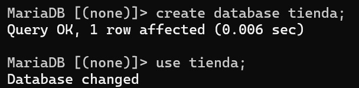</center>

<br>

<center>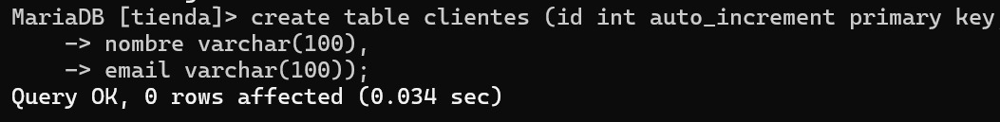</center>

<br>

<center>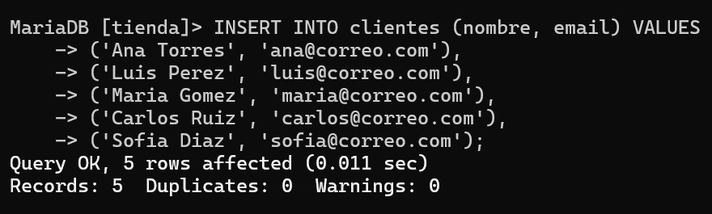</center>

<br>

<center>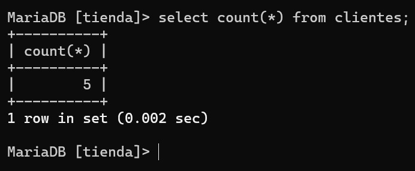</center>

<br>

Se creó correctamente la base de datos y la tabla clientes. Se insertaron cinco registros y se comprobó que la consulta devolviera un total de 5 clientes.

<br>

##### Paso 3. Realizar el respaldo

Se utilizó la herramienta "mariadb-dump" para generar una copia de seguridad de la base de datos.

<br>

<center>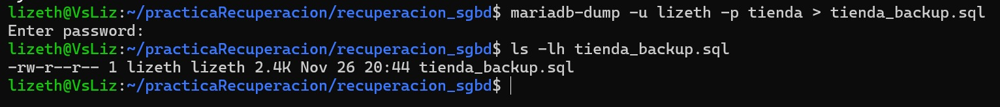</center>

<br>

Después se verificó que el archivo se hubiera creado correctamente con:

<br>

```bash
ls -lh tienda_backup.sql
```

<br>

Se generó correctamente el archivo "tienda_backup.sql", con un tamaño aproximado de 2.4 KB.

<br>

##### Paso 4. Simular la pérdida de información

Para simular un desastre, se ingresó nuevamente a MariaDB y se eliminó la base de datos.

<br>

<center>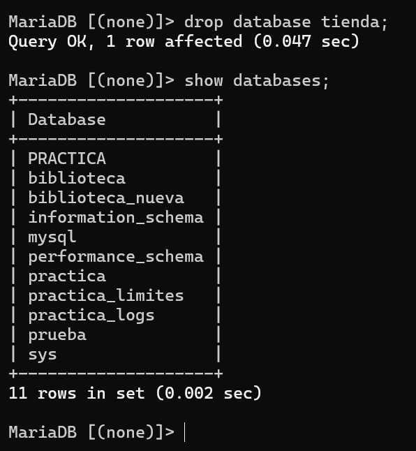</center>

<br>

La base de datos "tienda" dejó de aparecer en la lista, comprobando que había sido eliminada.

<br>

##### Paso 5. Restaurar el respaldo

Se utilizó el archivo generado anteriormente para recuperar la base de datos.

<br>

<center>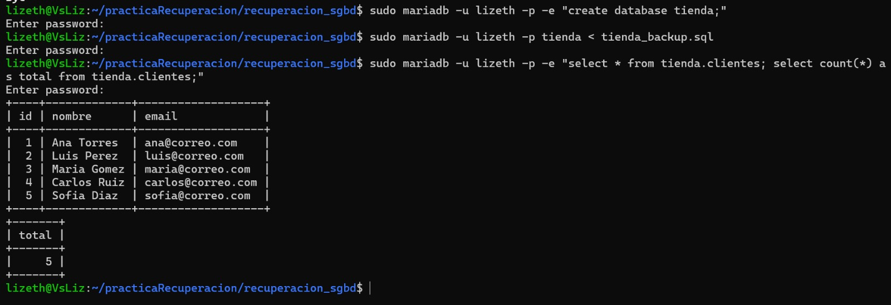</center>

<br>

Posteriormente, se verificó la información recuperada con:

<br>

```bash
mariadb -u lizeth -p -e "SELECT * FROM tienda.clientes;"
```

<br>

También se comprobó la cantidad de registros:

<br>

```bash
mariadb -u lizeth -p -e "SELECT COUNT(*) FROM tienda.clientes;"
```

<br>

La restauración se realizó correctamente. Se recuperaron los cinco clientes que se encontraban almacenados antes de eliminar la base de datos.

<br>

#### PARTE B. Recuperación de datos posteriores al respaldo mediante binlog

<br>

##### Paso 1. Activar el registro binario

Para permitir la recuperación de los cambios realizados después del respaldo, fue necesario activar el registro binario de MariaDB.

- Se editó el archivo de configuración:

<br>

```bash
sudo nano /etc/mysql/mariadb.conf.d/50-server.cnf
```

- Se agregaron las siguientes configuraciones:

<br>

<center>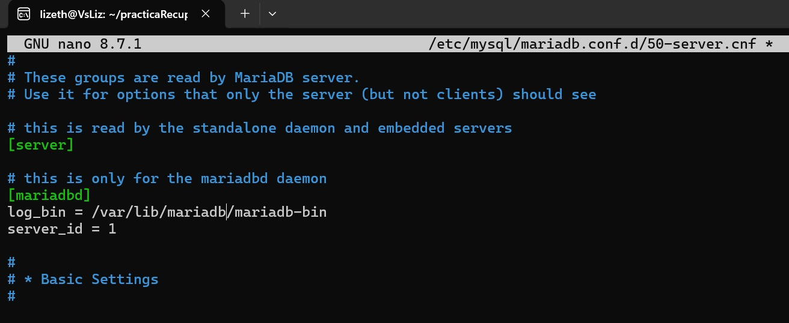</center>

<br>

- Se utilizó "/var/lib/mariadb/" como directorio para el registro binario, de acuerdo con la ubicación de datos de MariaDB en el sistema.

- Después se reinició el servicio:

<br
>

```bash
sudo systemctl restart mariadb
```

<br>

- Se verificó su funcionamiento:

<br>

```bash
sudo systemctl status mariadb
```

<br>

- Y se comprobó que el registro binario estuviera activado:

<br>

<center>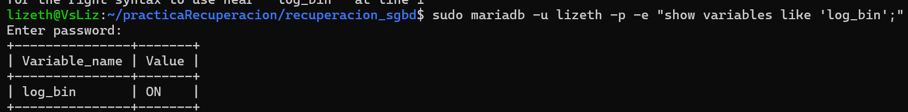</center>

<br>

El servicio MariaDB quedó activo y la variable "log_bin" mostró el valor "ON".

<br>

##### Paso 2. Crear un respaldo con la posición del binlog

Se realizó un nuevo respaldo utilizando la opción "--flush-logs" y "--master-data=2".

<br>

```bash
mariadb-dump -u lizeth -p --databases tienda --flush-logs --master-data=2 > tienda_pitr.sql
```

<br>

Después se consultó la posición del registro binario guardada en el archivo:

<br>

<center>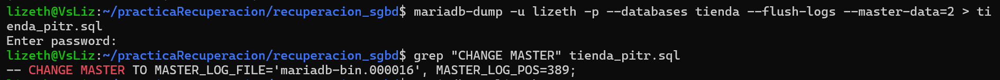</center>

<br>

Se identificó el archivo "mariadb-bin.000016" y la posición inicial "389", que se utilizaron posteriormente para recuperar los cambios.

<br>

##### Paso 3. Insertar nuevos registros

Se ingresó a MariaDB y se agregaron dos clientes nuevos a la tabla.

<br>

<center>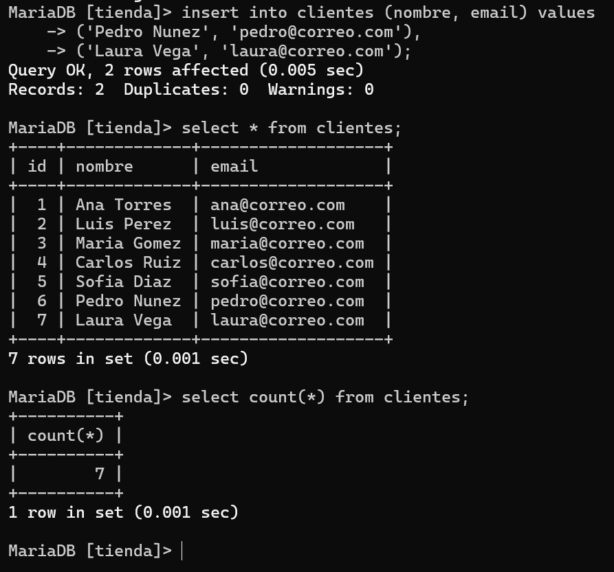</center>

<br>

Se insertaron correctamente dos nuevos clientes: Pedro Nunez y Laura Vega.

La tabla pasó de tener cinco registros a tener siete.

<br>

##### Paso 4. Registrar la hora y simular el error

Se consultó la fecha y hora del servidor mediante:

<br>

<center>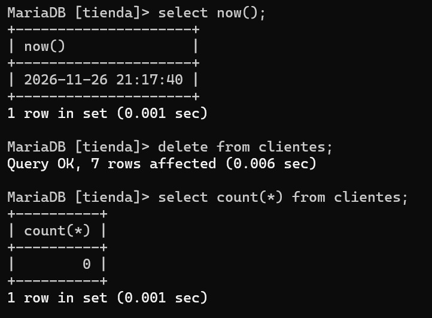</center>

<br>

Se obtuvo como resultado: 2026-11-26 21:17:40

Posteriormente, se simuló un error humano eliminando todos los registros de la tabla:

<br>

<center>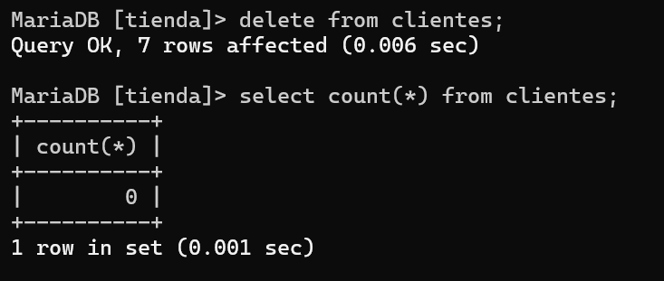</center>

<br>

La consulta DELETE eliminó los siete registros y el conteo devolvió cero.

Esto permitió simular la pérdida accidental de información.

<br>

##### Paso 5. Restaurar el respaldo completo

Se restauró el archivo "tienda_pitr.sql":

<br>

<center>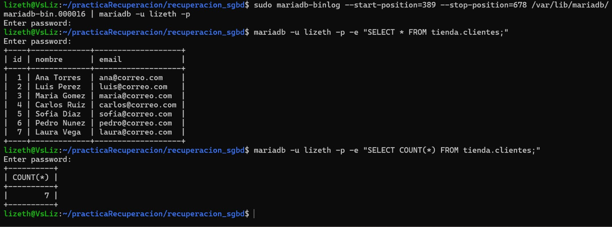</center>

<br>

Después se verificó la información y se recuperaron los cinco clientes originales del respaldo. Sin embargo, todavía faltaban Pedro Nunez y Laura Vega, ya que fueron agregados después de realizarlo.

<br>

##### Paso 6. Recuperar los cambios mediante mariadb-binlog

Se consultó el contenido del registro binario para identificar las operaciones que se habían realizado después del respaldo.

<br>

<center>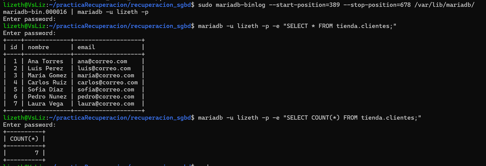</center>

<br>

Se identificó la operación INSERT que agregó a Pedro Nunez y Laura Vega.

El registro mostró que la transacción finalizó en la posición 678.

El comando se ejecutó correctamente y permitió recuperar los dos registros que se habían agregado después del respaldo, sin volver a ejecutar la operación DELETE accidental. Finalmente, se consultaron nuevamente los registros de la tabla:

<br>

```bash
mariadb -u lizeth -p -e "SELECT * FROM tienda.clientes;"
```

<br>

También se comprobó el total:

<br>

```bash
mariadb -u lizeth -p -e "SELECT COUNT(*) FROM tienda.clientes;"
```

<br>

La recuperación fue exitosa. Se obtuvieron nuevamente los siete registros

El conteo final fue de siete clientes.

<br>
<br>
<br>
<br>

---

<br>

### CONCLUSIÓN

<br>

Durante esta práctica aprendi la importancia de realizar respaldos periódicos para proteger la información almacenada en una base de datos. Mediante "mariadb-dump" es posible generar una copia de seguridad y restaurar los datos originales después de eliminar accidentalmente una base de datos.

También aprendi a utilizar el registro binario (binlog), el cual permite recuperar los cambios realizados después de un respaldo. Gracias a esta herramienta fue posible recuperar los dos clientes agregados posteriormente sin volver a aplicar la operación que eliminó los registros.